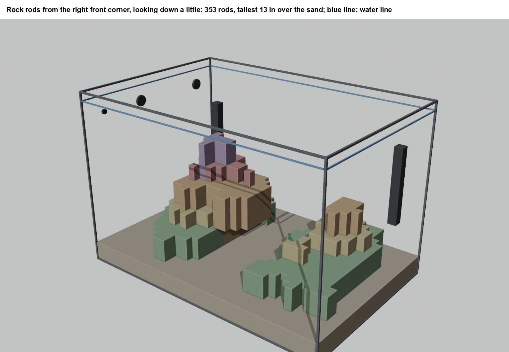

# aquascape_cfd

Water flow in a reef tank, modeled before the tank is wet. Two wavemakers, a return nozzle, a sand bed and a rock
structure, run through FluidX3D (a GPU lattice-Boltzmann solver) and drawn as nine cuts through the water: looking down
at three heights, through the front glass at three depths, from the side at three stations. Plus a tool for shaping the
rock in MS Paint and seeing what the shape does to the flow.

Built for one 90 gallon rimless tank (35.5 × 23.5 in inside, 22.1 in of water, 2.5 in of sand). The tank numbers sit in
one block at the top of `src/cfd_tank.py`; the holes in `tank/holes.csv`. Changing them to your tank is a short job for
you or your AI; see `AGENTS.md`.

This is a hobby project, shared because it was fun and might save someone the same 10-15 hours. It runs; it has not been
checked against a real tank. Treat the numbers as "which layout is better", not "what speed is this coral seeing".

## What it shows

Open tank, pumps only, 20 s average, looking down 1 in over the sand:


The same pumps with the rock in. Side cut through the main rock, looking from the right pane. The solid tan is the rock
the cut passes through; the pale wash is all the rock behind the glass, the far one outlined solid, the near one dotted:


The rock itself, shaped as 1 in square rods and rendered in Blender:



Each `flow_images/*/` folder holds nine views plus `numbers.txt`.

## Videos

The averages above hide most of what the water does. `src/flow_anim.py` draws every 0.2 s of a run and joins the
frames: 20 s of tank time played at 2x speed, one 10 s video per view. The "starved" patches turn out to get swept every few
seconds; the front-glass jet split wanders. Videos are not in git; these five are hosted by GitHub.

Side cut through the main rock (far):

https://github.com/user-attachments/assets/3206b5c0-3424-4e4e-9eac-82374bf0f045

Side cut through the overhang (middle):

https://github.com/user-attachments/assets/1174b636-ddf7-4255-8576-33cfb77a4fa6

Side cut through the right rock (near):

https://github.com/user-attachments/assets/40880cc2-a4ac-4e59-8525-4c42911cec82

Through the front glass, mid-depth:

https://github.com/user-attachments/assets/b514192b-25f4-480b-a2fe-b85198d9533a

Looking down, 1 in over the sand:

https://github.com/user-attachments/assets/75cc8db0-5695-4020-b8a1-f0eec0a51c4f

## What you need

- A GPU with OpenCL (any recent NVIDIA, AMD or Intel). A 90 s run on a 4 mm grid is about 3 minutes on a mid-range card.
- [FluidX3D](https://github.com/ProjectPhysX/FluidX3D), cloned beside this folder (or anywhere, with `FLUIDX3D` set to
  its path), and whatever builds it on your machine (Visual Studio Build Tools on Windows; `make` elsewhere).
- Python 3.12 with `pip install -r requirements.txt`.
- [Blender](https://www.blender.org/) 4 or 5 for the rock renders (`BLENDER` env var, or on PATH).
- Windows was the build machine. Nothing is Windows-only on purpose except the default Blender path and the Arial font
  the rod tool draws with.

## Quick start

```
python src/cfd_tank.py prepare            # points FluidX3D's setup.cpp at src/cfd_tank.cpp, sets its defines
# build FluidX3D (Release, x64)
python src/cfd_tank.py run --case open_tank --t 90 --pumps "3:forward,32.5:left" --rfg-tilt 20
python src/cfd_tank.py views --case open_tank --out flow_images/open_tank --title "Open tank"
python src/rock_rods.py draw two_bommies  # the rock's views to paint on, and the Blender corners
python src/rock_rods.py stl two_bommies
python src/cfd_tank.py run --case rock --t 60 --warm open_tank --pumps "3:forward,32.5:left" --rfg-tilt 20 --stl stl/rods_two_bommies.stl
python src/cfd_tank.py views --case rock --out flow_images/rock --title "With the rock"
```

Raw fields land in `FluidX3D/bin/reef_out/<case>/` (about 140 MB a run). `--warm` starts a run from another's end
instead of still water: half the time, same answer.

## Shaping rock

`src/rock_rods.py` treats the rock as a grid of 1 in square rods on the sand, each its own height. It draws a top view,
a front view and a side view, with a copy of each to paint on in MS Paint. Eyedrop a color off the drawing and paint:
green 3 in, yellow 5, orange 8, red 10, purple 13; white cuts a rod out; a color on open sand adds a rod. Then
`python src/rock_rods.py update NAME` reads the paint, redraws, and rerenders the Blender corners. Undercuts (ledges,
overhangs) are set in words: `set NAME --x 14:18 --y 8:17 --bottom 3.5`. A floating check refuses rock with nothing
holding it up. `stl` writes the shape for the flow run.

`rock_rods/two_bommies/` is the shape in the pictures: heights.csv and bottoms.csv are the whole record.

## What is in the pictures

- Color: 20 s mean speed, in inches per second, in five bands: starved (under 2), low (2-4), LPS (4-8), SPS (8-12),
  hot (over 12). Rules of thumb from reef-keeping, not measurements.
- Arrows: mean direction in the plane of the cut; motion through the page does not show. Length goes as the square root
  of speed so slow water still shows its way.
- Red arrow or ring: a pump and the way it points. Pale tan: rock. Deeper tan: the sand bed.
- `numbers.txt`: tank mean, sand band, fastest water over the sand (sand starts to move at about 13 in/s), dead sand.

## Layout

```
src/        cfd_tank.py (prepare, run, views), cfd_tank.cpp (the FluidX3D setup), rock_rods.py (+ rock_rods_blender.py),
            flow_anim.py (videos), no_rock_sweep.py (the pump placement sweep that picked the setup)
tank/       holes.csv: return and drain positions
notes/      how the pump and nozzle geometry were measured off vendor pictures, with the scripts
rock_rods/  the rock as rods (csv) and its drawings
rock_images/  Blender renders of the rock
stl/        the rock for the solver
flow_images/  1_open_tank, 2_two_bommies: nine views each; no_rock/ranking.csv: the pump sweep's numbers
```

## License

MIT for everything here (see `LICENSE`). FluidX3D is not included and has its own license: no commercial use, no
military use, publish altered source with published results. `src/cfd_tank.cpp` and the defines `prepare` sets are the
altered source; that is why they are here.
